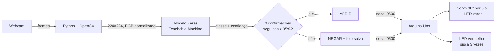

# Fechadura Inteligente

Controle de acesso por **reconhecimento facial**: a webcam alimenta um modelo de visão computacional em Python, que decide se a pessoa é autorizada e manda um **Arduino** abrir a fechadura (servo motor) ou negar o acesso.



## Como funciona

**No computador (`reconhecimento.py`)**
- Captura a webcam com OpenCV, converte cada frame de BGR para RGB, redimensiona para 224×224 e normaliza para o intervalo [-1, 1], o mesmo pré-processamento do Teachable Machine.
- Só libera o acesso depois de **3 reconhecimentos consecutivos** com confiança **≥ 95%**, o que evita abrir por um frame isolado.
- Envia `ABRIR` ou `NEGAR` ao Arduino pela porta serial. A porta é **detectada automaticamente** (Arduino, CH340 ou USB) e pode ser fixada em `PORTA_MANUAL`. Um intervalo de 5 segundos impede repetir o mesmo comando a cada frame.
- Cada acesso negado gera uma **foto com data e hora** em `acessos_negados/`.
- Mostra o vídeo com o resultado na tela: laranja enquanto confirma, verde quando libera, vermelho quando nega.

**No Arduino (`fechadura_versao_final_servo.ino`)**
- `ABRIR`: acende o LED verde e gira o servo para 90° (fechadura aberta) por 3 segundos, depois volta a 0°.
- `NEGAR`: mantém o servo fechado e pisca o LED vermelho 3 vezes.
- Ao ligar, pisca os dois LEDs como teste.

### Destaque técnico: modelo do Teachable Machine no Keras atual

O Teachable Machine exporta camadas `DepthwiseConv2D` com o argumento `groups`, que o Keras 3 não aceita mais, e o modelo falha ao carregar. O script usa o Keras 2 legado (`tf-keras`) e registra uma subclasse da camada que descarta esse argumento, o que permite carregar o arquivo exportado sem retreinar nada.

## Montagem

- **Arduino Uno**
- LED verde no pino **6** e LED vermelho no pino **7** (com resistores)
- Servo motor no pino **9**
- Webcam USB

## Como executar

Pré-requisito: **Python 3.12** e a Arduino IDE.

### 1. Treinar o modelo (Teachable Machine)

O modelo não fica no repositório, porque é treinado com o rosto de quem vai ser reconhecido.

1. Acesse [teachablemachine.withgoogle.com](https://teachablemachine.withgoogle.com/) e crie um **Image Project → Standard image model**.
2. Crie uma classe com o **seu nome** e grave amostras do seu rosto pela webcam.
3. Crie uma classe chamada exatamente **`desconhecido`**, com fotos de outras pessoas e do ambiente vazio.
4. Treine e exporte em **Tensorflow → Keras**. Coloque `keras_model.h5` e `labels.txt` na pasta do projeto.

### 2. Ambiente Python

```bash
python -m venv venv
venv\Scripts\activate          # Windows
source venv/bin/activate       # Linux/macOS
pip install -r requirements.txt
```

A instalação do TensorFlow pode levar alguns minutos na primeira vez.

### 3. Arduino

Abra `fechadura_versao_final_servo.ino` na Arduino IDE e faça o **Upload** para o Arduino Uno. Só é preciso fazer isso uma vez.

### 4. Rodar

Com o Arduino conectado por USB:

```bash
python reconhecimento.py
```

Pressione **ESC** para encerrar. Se a porta não for encontrada, defina `PORTA_MANUAL` (ex.: `"COM3"`) no início do script.

## Estrutura

```
reconhecimento.py                 reconhecimento facial e comunicação serial
fechadura_versao_final_servo.ino  sketch do Arduino (LEDs + servo)
requirements.txt                  dependências Python
keras_model.h5, labels.txt        modelo exportado do Teachable Machine (não versionados)
acessos_negados/                  fotos das tentativas negadas (criada automaticamente)
```
